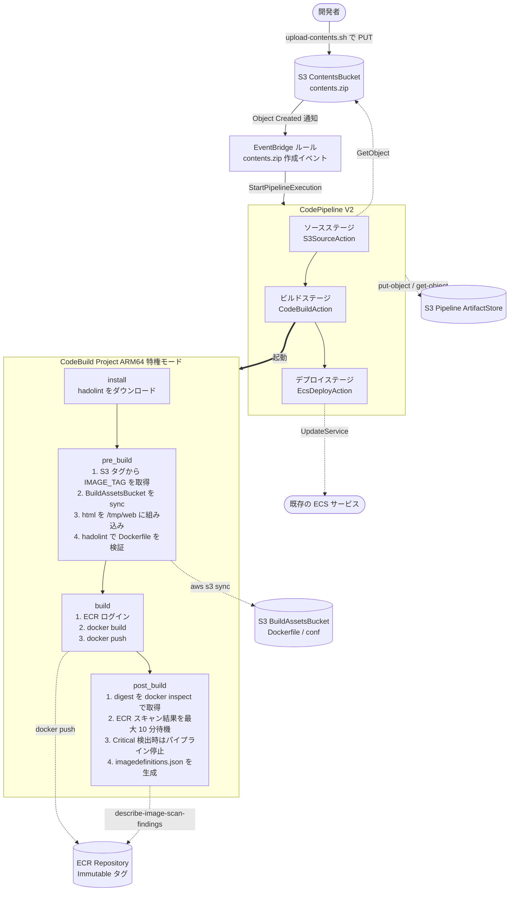

# aws-cdk-ecs-native-blue-green-cicd-pipeline

S3 への `contents.zip` アップロードを契機に、web コンテナイメージをビルドして ECR に push し、ECS Service の **Native Blue/Green デプロイ** を起動する CI/CD パイプラインの AWS CDK 実装。

スコープは **CI/CD パイプライン本体のみ**。VPC / ALB / ECS Cluster / ECS Service などのアプリケーションランタイムは本パイプラインの管理外で、別途構築されている前提とする。

## 全体像



## 前提条件

本パイプラインの **外部** で次が満たされている必要がある。

- **ECS Cluster / ECS Service** が構築済み
- ECS Service の `deploymentConfiguration.strategy = BLUE_GREEN` で構成済み (本パイプラインは strategy 自体を管理せず、`UpdateService` を呼ぶだけ)
- ALB / TargetGroup / リスナールール (Blue / Green) が ECS Service に紐づいている
- TaskDefinition のコンテナ名のうち、本パイプラインが更新する対象 (例: `web`) を `config/app-config.ts` の `containerName` と一致させる
- 参考実装: [non-97/ecs-native-blue-green v3.0.0](https://github.com/non-97/ecs-native-blue-green/tree/v3.0.0)

## ディレクトリ構成

```
.
├── assets/
│   └── web/                       CDK が BuildAssetsBucket に配信する固定資材
│       ├── Dockerfile
│       └── conf/default.conf
├── bin/
│   └── app.ts                     エントリポイント
├── lib/
│   ├── config/
│   │   └── app-config.ts          AppConfig (App レベル注入)
│   ├── constructs/
│   │   ├── index.ts               root barrel
│   │   ├── deployment-pipeline.ts CodePipeline + CodeBuild + EventBridge
│   │   ├── secure-bucket.ts       SecureBucket (versioned, BLOCK_ALL, enforceSSL)
│   │   └── secure-ecr-repository.ts SecureEcrRepository (Immutable, scan on push)
│   └── stacks/
│       └── cicd-pipeline-stack.ts
├── scripts/
│   └── upload-contents.sh         contents.zip を tag 付きで PUT するシェル
├── test/stacks/                   snapshot + fine-grained assertion
├── cdk.json
├── package.json
├── tsconfig.json
└── README.md
```

## セットアップ

### 1. 依存インストール

```sh
pnpm install
```

### 2. 設定値の編集

`lib/config/app-config.ts` を実環境の値で書き換える。

```ts
export const appConfig: AppConfig = {
  env: {
    account: process.env.CDK_DEFAULT_ACCOUNT ?? "",
    region: process.env.CDK_DEFAULT_REGION ?? "",
  },
  ecsClusterName: "<既存 ECS Cluster 名>",
  ecsServiceName: "<既存 ECS Service 名>",
  containerName: "web",
  taskExecutionRoleArn: "<既存 TaskExecutionRole の ARN>",
};
```

`taskExecutionRoleArn` は、ECS Service の TaskDefinition から取得できる。

```sh
TD_ARN=$(aws ecs describe-services \
  --cluster "<cluster-name>" \
  --services "<service-name>" \
  --query "services[0].taskDefinition" --output text)

aws ecs describe-task-definition --task-definition "$TD_ARN" \
  --query "taskDefinition.executionRoleArn" --output text
```

### 3. CDK Bootstrap (初回のみ)

```sh
cdk bootstrap aws://<account>/<region>
```

### 4. デプロイ

```sh
cdk deploy
```

CFN Output として `ContentsBucketName` が出力されるので控えておく (shell script から自動解決もされる)。

## 使い方

### contents.zip のアップロード

`scripts/upload-contents.sh` で、ローカルの `html/` ディレクトリを `contents.zip` に固めて S3 にアップロードする。

```sh
./scripts/upload-contents.sh <version> <html_directory>

# 例
./scripts/upload-contents.sh 1.0.0 ./assets/html
./scripts/upload-contents.sh 1.2.3 ./src/container/web/html my-contents-bucket
```

- `version` は ECR イメージタグとして使われる SemVer (例: `1.0.0`)
- `html_directory` の中身は zip 内で必ず `html/` ディレクトリにリネームされて格納される
- ContentsBucket 名は CFN Output から自動解決 (引数で明示指定も可)

### パイプラインの実行

`contents.zip` の PUT を検知して EventBridge → CodePipeline が自動起動する。AWS マネジメントコンソールの CodePipeline 画面で進捗を確認できる。

成功すると ECS Service の TaskDefinition のうち `containerName` で指定したコンテナのみが新イメージで上書きされ、Native Blue/Green デプロイが ECS 側で起動する。

## 主要な設計判断

| 判断 | 採用 | 理由 |
|------|------|------|
| ECS Service の管理 | **本パイプラインの管理外** | スコープを CI/CD だけに絞り込み、ECS リソースは別 IaC で管理する責務分離 |
| ECR タグ戦略 | `IMMUTABLE` + SemVer | 同一バージョン再 push を `ImageTagAlreadyExistsException` で運用ミス検知 |
| ECS への image 受け渡し | tag ではなく **digest** (`<repo>@sha256:...`) | tag 上書き耐性のためのコンテナ業界ベストプラクティス |
| パイプラインのトリガ | S3 ネイティブ EventBridge 通知 (`detail-type: "Object Created"`) | CloudTrail 不要、`object.key` を厳密フィルタ可能 |
| デプロイ方式 | CodePipeline 標準 `EcsDeployAction` (imagedefinitions.json) | ECS Service の strategy=BLUE_GREEN が事前構成済みなら、これだけで Native B/G が発動 |
| CodeBuild compute | **ARM64 (Graviton)** | デプロイ先 ECS Task が ARM64 のためアーキ一致 |
| Dockerfile lint | hadolint (failure-threshold error) | warning は許容、error のみ停止 |
| 脆弱性スキャン | ECR enhanced scanning + post_build で待機 / Critical 検出で停止 | fail-closed |
| ベースイメージ取得元 | `public.ecr.aws/docker/library/nginx:stable-alpine` | Docker Hub の rate limit (429) 回避 |

## 開発

```sh
# 型チェック
pnpm exec tsc --noEmit

# ユニットテスト (snapshot + fine-grained assertions)
pnpm test

# スナップショット更新
pnpm exec jest -u

# CDK 操作
cdk synth
cdk diff
cdk deploy
cdk destroy
```

## トラブルシューティング

| 症状 | 原因 | 対処 |
|------|------|------|
| CodeBuild の DOWNLOAD_SOURCE で `Unknown runtime named 'docker'` | `LinuxBuildImage.STANDARD_7_0` 以降は `runtime-versions` に `docker` を書けない | 既に修正済み (`runtime-versions` から削除) |
| `hadolint: cannot execute binary file: Exec format error` | hadolint バイナリのアーキ不一致 | CodeBuild が ARM64 なので `hadolint-Linux-arm64` を使う (修正済み) |
| ECS タスクが起動直後に `[FATAL tini (7)] exec /docker-entrypoint.sh failed: Exec format error` | ビルドした image のアーキが ECS Task と不一致 | CodeBuild を `LinuxArmBuildImage` に変更 (修正済み) |
| docker build で `429 Too Many Requests` (Docker Hub) | Docker Hub の unauthenticated pull rate limit | ベースイメージを `public.ecr.aws/docker/library/...` に切り替え (修正済み) |
| `CannotPullContainerError: 403 Forbidden` (ECS タスク起動時) | ECS の TaskExecutionRole が ECR repository から pull できない | `app-config.ts` の `taskExecutionRoleArn` を実 ARN にし、`cdk deploy` で ECR Repository Policy を更新 |
| `ImageTagAlreadyExistsException` | 同一 version の再 push (ECR Immutable) | `version` を新しい値に変えて再 PUT |
| パイプラインがトリガされない | `cdk deploy` 未実施 / イベント伝搬遅延 / Stack 名違い | CFN Stack のデプロイ完了を確認、CodePipeline 履歴を確認 |

## ライセンス / 参照

- 参考リポジトリ: [non-97/ecs-native-blue-green v3.0.0](https://github.com/non-97/ecs-native-blue-green/tree/v3.0.0)
- AWS DevOps Blog: [Choosing between Amazon ECS Blue/Green Native or AWS CodeDeploy in AWS CDK](https://aws.amazon.com/blogs/devops/choosing-between-amazon-ecs-blue-green-native-or-aws-codedeploy-in-aws-cdk/)
- AWS Containers Blog: [Migrating from AWS CodeDeploy to Amazon ECS for blue/green deployments](https://aws.amazon.com/blogs/containers/migrating-from-aws-codedeploy-to-amazon-ecs-for-blue-green-deployments/)
